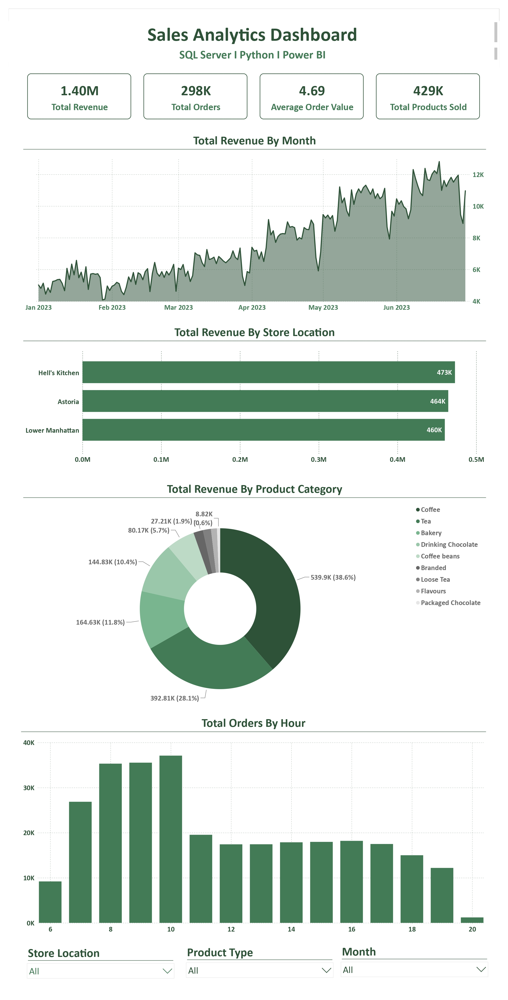

# ☕ Coffee Shop Sales Analytics Dashboard

> An end-to-end Business Intelligence project built using **SQL Server, Python, and Power BI** to analyze over **298,000 coffee shop sales transactions**.

## 📖 Project Overview

This project focuses on analyzing coffee shop sales data to uncover valuable business insights and support data-driven decision-making.

The complete analytics pipeline includes:

- Data loading using Python
- Data storage in Microsoft SQL Server
- SQL-based business analysis
- Interactive dashboard development with Power BI

## 🎯 Business Objectives

- Analyze overall sales performance
- Identify top-performing stores
- Discover best-selling products
- Analyze hourly and weekly sales patterns
- Evaluate product category performance
- Build an executive dashboard for decision-makers

## 🛠️ Tech Stack

| Technology | Purpose |
|------------|---------|
| Python | Data Import (ETL) |
| SQL Server | Data Storage |
| SQL | Data Analysis |
| Power BI | Data Visualization |
| DAX | KPI Calculations |
| GitHub | Version Control |

## 📊 Dashboard Features

The dashboard includes:

- 💰 Total Revenue
- 🛒 Total Orders
- 📦 Total Products Sold
- 💵 Average Order Value
- 📈 Revenue Trend
- 🏪 Revenue by Store
- ☕ Top 10 Products
- 🥐 Revenue by Category
- 🕒 Orders by Hour
- 🎛️ Interactive Filters (Store, Category, Month)

## 🧮 SQL Analysis

The project contains **20 SQL queries** covering:

- Overall KPIs
- Store Performance Analysis
- Product Performance Analysis
- Revenue Analysis
- Time-Based Analysis
- Category Analysis
- Ranking Functions (`RANK`, `DENSE_RANK`)
- Common Table Expressions (CTEs)
- Running Total
- Moving Average
- Revenue Share

## 📈 Key Business Insights

- Hell's Kitchen generated the highest total revenue.
- Lower Manhattan recorded the highest average order value.
- Peak sales occurred between **8:00 AM and 10:00 AM**.
- Coffee products contributed the largest share of total revenue.
- Monday generated the highest revenue among weekdays.

## 📚 What I Learned

Throughout this project, I gained hands-on experience with:

- Writing business-focused SQL queries
- Using Window Functions and CTEs
- Building interactive Power BI dashboards
- Creating KPI measures using DAX
- Transforming raw data into actionable business insights

## 👨‍💻 Author

**Mete Arabacı**
